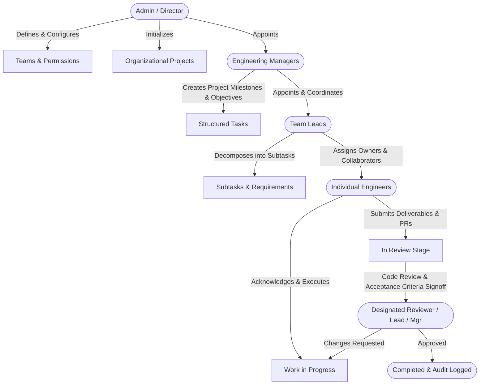
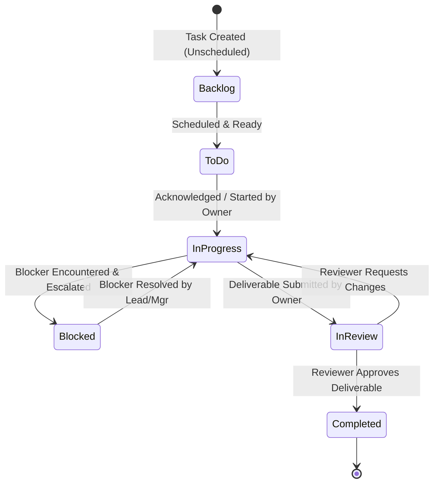
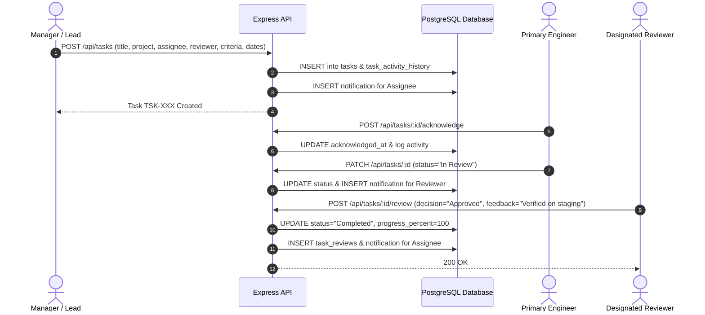

# Complete Role-Based Team Task & Project Management System

## 1. System Overview

The **Who Is Doing What? — Technical Team Task Manager** has been elevated into an enterprise-grade, role-based project and task governance workspace.

It provides complete visibility into:
- **Who assigned what task**
- **What requirements, acceptance criteria, and repositories are involved**
- **Who owns the task and which team members are collaborating**
- **Current status (Backlog → To Do → In Progress → In Review → Completed / Blocked)**
- **Active blockers and escalation paths**
- **Assigned reviewer and recorded review approval / change requests**

---

## 2. Core Architecture & Database Schema

The database model extends the existing PostgreSQL `task` database with automated migration that preserves legacy `employees`, `project_allotments`, and `daily_progress_reports`.

```
                    ┌─────────────────────────┐
                    │          Users          │
                    │  (Admin, Mgr, Lead, IC) │
                    └────────────┬────────────┘
                                 │
     ┌───────────────────────────┼───────────────────────────┐
     │                           │                           │
     ▼                           ▼                           ▼
┌─────────┐                ┌──────────┐                ┌───────────┐
│  Teams  │                │ Projects │                │   Tasks   │
└─────────┘                └──────────┘                └─────┬─────┘
                                                             │
                  ┌──────────────────────┬───────────────────┼─────────────────────┐
                  ▼                      ▼                   ▼                     ▼
            ┌───────────┐          ┌───────────┐       ┌───────────┐         ┌───────────┐
            │ Subtasks  │          │ Comments  │       │  Reviews  │         │ Activity  │
            └───────────┘          └───────────┘       └───────────┘         └───────────┘
```

---

## 3. Workflow & System Diagrams

### A. Overall Organization Workflow



---

### B. Role-Based Dashboards & Permissions

#### 1. Admin Workflow
- Organization-wide governance.
- Add and manage user accounts, assign roles (`Admin`, `Manager`, `Team Lead`, `Individual`).
- View comprehensive analytics, metrics, overdue tasks, and audit logs.

#### 2. Manager Workflow
- Manage project streams, deliverables, and timelines.
- Monitor team workload and identify overloaded or blocked team members.
- Delegate work to team leads or engineers.

#### 3. Team Lead Workflow
- Distribute tasks within authorized scope and technical domain.
- Create subtask breakdowns and acceptance criteria.
- Conduct technical reviews and unblock engineering impediments.

#### 4. Individual Team Member Workflow
- Personal "My Tasks" view showing deadlines, assigners, and criteria.
- One-click task acknowledgment and progress updates.
- Record blockers and submit daily progress reports.
- Submit work for reviewer signoff.

---

### C. Task Lifecycle & Approval State Machine



---

### D. Task Assignment & Reassignment Audit Flow



---

## 4. Key Endpoints & API Reference

| Method | Path | Description | Authorization |
| :--- | :--- | :--- | :--- |
| `GET` | `/api/auth/me` | Fetch active authenticated user & role | All authenticated |
| `GET` | `/api/users` | List organization users & roles | All authenticated |
| `POST` | `/api/users` | Register new organization user | Admin only |
| `PATCH` | `/api/users/:id` | Update user role and status | Admin only |
| `GET` | `/api/projects` | List projects with completion telemetry | All authenticated |
| `POST` | `/api/projects` | Create new project stream | Admin, Manager |
| `GET` | `/api/tasks` | Filtered task list (project, status, priority, owner) | All authenticated |
| `POST` | `/api/tasks` | Create structured task with full assignment metadata | Admin, Manager, Team Lead |
| `PATCH` | `/api/tasks/:id` | Update task details / status / reassignment | Role-checked |
| `POST` | `/api/tasks/:id/acknowledge` | Acknowledge task assignment | Assignee / Collab |
| `POST` | `/api/tasks/:id/review` | Submit formal review decision & feedback | Reviewer, Manager, Admin |
| `GET` | `/api/analytics/workload` | Real-time member capacity & estimated hours | All authenticated |
| `GET` | `/api/analytics/dashboard` | Dashboard metrics & activity timeline | All authenticated |
| `GET` | `/api/notifications` | In-app user notifications & alerts | All authenticated |
| `GET` | `/api/daily-reports` | Retrieve daily progress reports by date | All authenticated |
| `PUT` | `/api/daily-reports` | Submit daily progress report | All authenticated |
| `GET` | `/api/project-allotments`| Legacy allotment records | All authenticated |

---

## 5. Verification & Test Suite

The automated test runner (`server/test_verify.ts`) tests:
1. Database initialization and table creations without dropping data.
2. User seeding across all 4 roles (Shivam - Admin, Ramesh - Manager, Animesh/Vaibhav - Team Leads, Sakshi/Suraj/Priya - Individuals).
3. Task creation by Manager for an Individual engineer.
4. Status progression to In Progress and In Review.
5. Reviewer review and approval workflow transitioning task to Completed.
6. Reassignment with recorded audit reasons.

Run test command:
```bash
npx tsx server/test_verify.ts
```
Build verification:
```bash
npm run build
```
