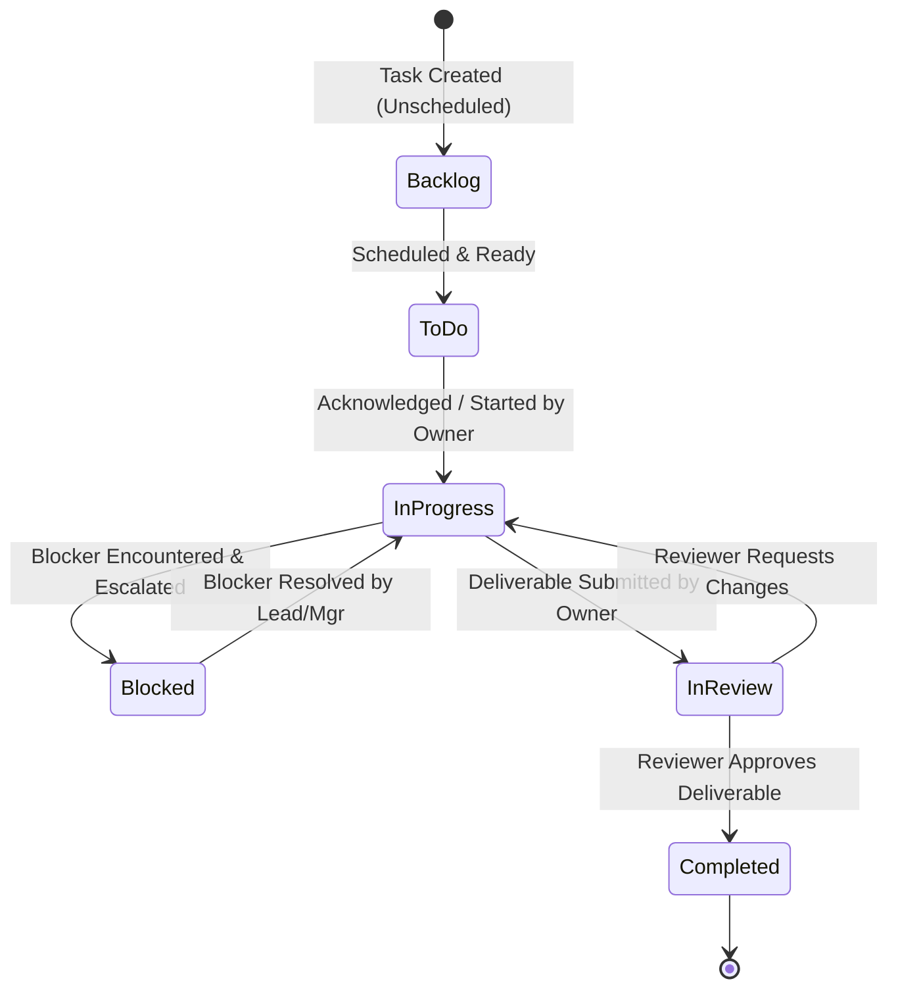
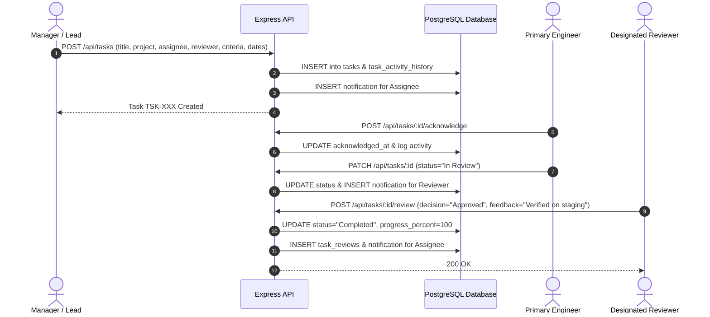

# Complete Role-Based Team Task & Project Management System

## 1. System Overview

The **Task Manager Portal** is a React/TypeScript and Express/PostgreSQL project and task workspace with role-scoped data access.

It provides complete visibility into:
- **Who assigned what task**
- **What requirements, acceptance criteria, and repositories are involved**
- **Who owns the task and which team members are collaborating**
- **Current status (Backlog → To Do → In Progress → In Review → Completed / Blocked)**
- **Active blockers and escalation paths**
- **Assigned reviewer and recorded review approval / change requests**

---

## 2. Core Architecture & Database Schema

The database model extends the existing PostgreSQL `task` database with automated migration that preserves legacy `employees`, `project_allotments`, and `daily_progress_reports`.

```
                    ┌─────────────────────────┐
                    │          Users          │
                    │  (Admin, Mgr, Lead, IC) │
                    └────────────┬────────────┘
                                 │
     ┌───────────────────────────┼───────────────────────────┐
     │                           │                           │
     ▼                           ▼                           ▼
┌─────────┐                ┌──────────┐                ┌───────────┐
│  Teams  │                │ Projects │                │   Tasks   │
└─────────┘                └──────────┘                └─────┬─────┘
                                                             │
                  ┌──────────────────────┬───────────────────┼─────────────────────┐
                  ▼                      ▼                   ▼                     ▼
            ┌───────────┐          ┌───────────┐       ┌───────────┐         ┌───────────┐
            │ Subtasks  │          │ Comments  │       │  Reviews  │         │ Activity  │
            └───────────┘          └───────────┘       └───────────┘         └───────────┘
```

---

## 3. Workflow & System Diagrams

### A. Overall Organization Workflow


---

### B. Role-Based Dashboards & Permissions

#### 1. Admin Workflow
- Organization-wide governance.
- Add and manage user accounts, assign roles (`Admin`, `Manager`, `Team Lead`, `Individual`).
- View comprehensive analytics, metrics, overdue tasks, and audit logs.

#### 2. Manager Workflow
- Manage project streams, deliverables, and timelines.
- Monitor team workload and identify overloaded or blocked team members.
- Delegate work to team leads or engineers.

#### 3. Team Lead Workflow
- Distribute tasks within authorized scope and technical domain.
- Create subtask breakdowns and acceptance criteria.
- Conduct technical reviews and unblock engineering impediments.

#### 4. Individual Team Member Workflow
- Personal "My Tasks" view showing deadlines, assigners, and criteria.
- One-click task acknowledgment and progress updates.
- Record blockers and submit daily progress reports.
- Submit work for reviewer signoff.

---

### C. Task Lifecycle & Approval State Machine



---

### D. Task Assignment & Reassignment Audit Flow



---

## 4. Key Endpoints & API Reference

| Method | Path | Description | Authorization |
| :--- | :--- | :--- | :--- |
| `GET` | `/api/auth/me` | Fetch active authenticated user & role | All authenticated |
| `GET` | `/api/users` | List users visible to the requester | Admin: all; Manager/Lead: managed teams; Individual: self |
| `POST` | `/api/users` | Register user with team and optional project memberships | Admin; Team Lead: Individual in own team |
| `PATCH` | `/api/users/:id` | Update profile, role, or team membership | Admin only; last Admin protected |
| `PATCH` | `/api/users/:id/deactivate` | Deactivate, audit, and optionally reassign active tasks | Admin; Manager/Lead: Individuals in managed teams |
| `GET` | `/api/projects` | List projects with completion telemetry | Admin: all; others: owned, led, or explicitly shared |
| `POST` | `/api/projects` | Create new project stream | Admin, Manager |
| `GET` | `/api/tasks` | Filtered task list (project, status, priority, owner) | Admin: all; others: scoped; Individual: assigned/collaborated |
| `GET` | `/api/tasks/:id` | Read task, subtasks, and dependencies | Same visibility as task list; out-of-scope returns 404 |
| `POST` | `/api/tasks` | Create structured task with full assignment metadata | Admin, Manager, Team Lead within authorized scope |
| `PATCH` | `/api/tasks/:id` | Update task details / status / reassignment | Project access required; Individual fields restricted |
| `POST` | `/api/tasks/:id/acknowledge` | Acknowledge task assignment | Assignee / Collab |
| `POST` | `/api/tasks/:id/review` | Submit formal review decision & feedback | Reviewer, Manager, Admin |
| `GET` | `/api/analytics/workload` | Real-time member capacity & estimated hours | Role/project/team scoped |
| `GET` | `/api/analytics/dashboard` | Dashboard metrics & activity timeline | Role/project/task scoped |
| `GET` | `/api/activity` | Recent task, project, and employee audit events | Admin, Manager, Team Lead; scoped |
| `GET` | `/api/notifications` | In-app user notifications & alerts | All authenticated |
| `GET` | `/api/daily-reports` | Retrieve daily progress reports by date | All authenticated |
| `PUT` | `/api/daily-reports` | Submit daily progress report | All authenticated |
| `GET` | `/api/project-allotments`| Legacy allotment records without relational ownership | Admin only |

### Authorization and migrations

- Project visibility is enforced in parameterized PostgreSQL queries, not only in the UI. Task lists, task IDs, comments, reviews, activity, subtasks, metrics, workload, and daily reports apply the requester's scope.
- Manager/Team Lead project access comes from project ownership, lead assignment, or an explicit `project_members` row. Individual access comes from project membership or assignment/collaboration.
- Existing databases receive additive `user_audit_history` and `project_activity_history` tables, report ownership/project/task columns when missing, and supporting indexes. Initialization removes legacy `Contributor` project-membership rows without an assigned task or owner/lead relationship.
- Employee removal is soft deactivation. Open assigned tasks require a replacement; reassignment, reviewer cleanup, membership removal, audit history, and account deactivation run in one transaction. The last active Admin cannot be deactivated or demoted.
- Name-only legacy allotment/employee endpoints are Admin-only because those records do not have reliable user/project foreign keys for safe team filtering.

### Authentication limitation

The existing application has a **development identity simulator**, not production authentication. The client sends `x-user-id` from local storage; the server reloads the user's role from PostgreSQL and rejects missing/inactive IDs, but a client can still spoof another active ID. Do not deploy this simulator as a security boundary. Replace it with verified credentials and server-managed sessions before production; role/project filtering does not prevent identity impersonation.

---

## 5. Verification & Test Suite

The database-backed RBAC suite (`server/authorization.test.ts`) tests Individual project/task/directory/dashboard scoping, Manager/Lead workload scope, direct task-ID visibility, unauthorized deactivation, and last-Admin protection. It requires a configured local `DATABASE_URL` and uses existing database records.

Run test command:
```bash
npx tsx server/test_verify.ts
npm run test:authorization
```
Build verification:
```bash
npm run build
```
